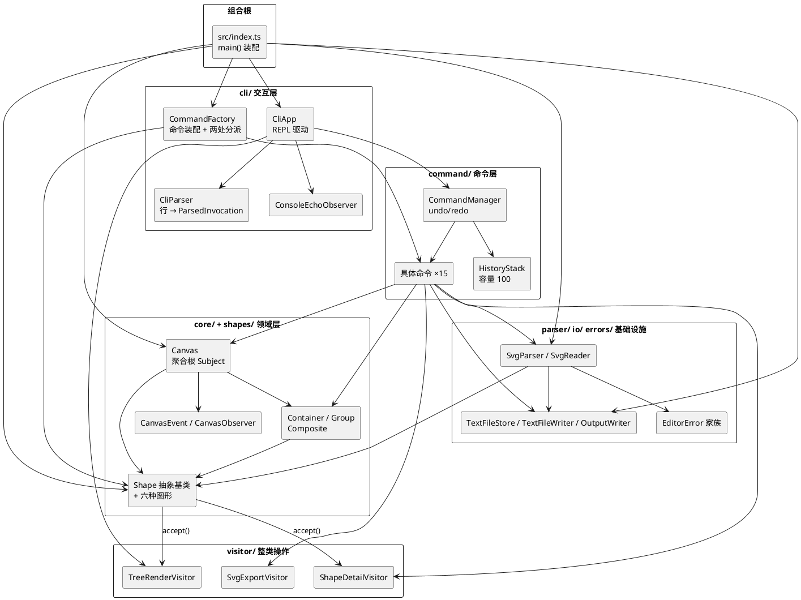

# SVG CLI 编辑器 · 架构方案与过程记录

> 用 TypeScript + Node.js 实现的命令行 SVG 编辑器：REPL 逐行读取命令，在内存中维护一棵 SVG 元素树，
> 命令通过 Command 模式支持 undo/redo，`save` / `read` 与 `.svg` 文件互转。
> 当前规模：**32 个测试套件、264 个测试用例 100% 通过**，`npx tsc --noEmit` 零报错。
>
> ```bash
> npm run cli        # 启动 REPL（ts-node src/index.ts）
> npm test           # Jest 全量单测（jest --runInBand）
> npx tsc --noEmit   # 静态类型检查
> ```

---

## 1. 架构方案

### 1.1 模块划分

代码全部位于 `src/`，按"领域内核 → 整类操作 → 命令 → 交互"分层，每个目录只负责一类职责：

| 目录 | 职责 | 主要类型 |
| --- | --- | --- |
| `src/errors/` | 统一异常体系，所有可预期失败都转成可读文案 | `EditorError`、`CommandError`、`ParseError`、`SvgParseError`、`CliError` |
| `src/core/` | 领域内核：图形基类、组合结构、画布聚合根、样式/属性值对象、事件与观察者、容器工厂接口 | `Shape`、`Container`、`Canvas`、`ShapeStyle`、`SvgAttributes`、`AttributePatch`、`CanvasEvent`、`CanvasSubject`、`CanvasObserver`、`ContainerFactory`、`DefaultContainerFactory` |
| `src/shapes/` | 六种具体图形的几何与组合实现；只实现自己的几何钩子 | `Rect`、`Circle`、`Ellipse`、`Line`、`Text`、`Group` |
| `src/visitor/` | 对图形的"整类操作"：树形渲染、SVG 序列化、属性明细 | `ShapeVisitor`、`TreeRenderVisitor`、`SvgExportVisitor`、`ShapeDetailVisitor` |
| `src/command/` | 命令抽象、撤销/重做栈、全部编辑命令 | `Command`、`BaseCommand`、`HistoryStack`、`CommandManager`，以及 `AddShapeCommand`、`RemoveShapeCommand`、`TranslateShapeCommand`、`ScaleShapeCommand`、`SetAttributeCommand`、`GroupCommand`、`UngroupCommand`、`AddToContainerCommand`、`BringToFrontCommand`、`SendToBackCommand`、`ShowCommand`、`InitCommand`、`CanvasCommand`、`ReadCommand`、`SaveCommand` |
| `src/cli/` | 交互层：行解析、命令装配、REPL 驱动、终端回显观察者 | `CliParser`、`CliApp`、`CommandFactory`、`ParsedInvocation`、`ConsoleEchoObserver`、`LineReader` |
| `src/parser/` | 手写 XML 解析与 SVG → 领域对象的映射 | `XmlTokenizer`、`XmlElement`、`SvgParser`、`SvgReader`、`ParsedDocument`、`SvgElementFactory`、`DefaultSvgElementFactory` |
| `src/io/` | 外部 IO 端口（只定义接口，实现由入口注入） | `TextFileStore`、`TextFileWriter`、`OutputWriter` |
| `src/index.ts` | **组合根**：唯一允许 `new` 具体实现、组装依赖并启动 REPL 的地方 | `main()` |

`tests/` 按被测模块分目录：`tests/core/`（含 Shape 基类与 Canvas/Container 组合语义）、`tests/visitor/`、`tests/parser/`、`tests/command/`、`tests/cli/`，另有 `tests/helpers/` 存放测试替身（`StubShape`、`StubContainerFactory`、`FakeOutputWriter`、`CliHarness` 等）；`shapes/` 与 `io/`、`errors/` 的细节通过上述用例间接覆盖。

### 1.2 组件图（PlantUML）



（箭头表示"依赖/调用"方向；`Shapes --> TreeVisitor` 是 `accept()` 的静态分派入口，实际实现类由调用方注入。）

### 1.3 设计模式的落地

#### 1.3.1 Command 模式：撤销/重做栈

- `src/command/Command.ts` 定义四个成员：`getName()`、`execute()`、`undo()`、`isUndoable()`。语义上 `execute` 负责正向变更，`undo` 负责精确逆向，命令本身只做"请求转发"，真正的状态修改落在 `Canvas` / `Container` / `Shape` 的领域方法里。
- `BaseCommand` 提供命令名与默认 `isUndoable() = true`，子类只写正/逆向逻辑。
- `HistoryStack` 是纯 LIFO 栈：默认容量 100，超过容量丢弃最早的一条；`snapshot()` 返回只读副本便于断言。
- `CommandManager` 是唯一的历史入口：
  - `execute(command)`：先执行；`isUndoable()` 为真则压入 undo 栈并清空 redo 栈；为假则**清空两个栈**（文档类命令之后禁止 undo/redo，与规范 4.3 一致）；
  - `undo()`：弹出 undo 栈顶、调用 `undo()`、压入 redo 栈；
  - `redo()`：弹出 redo 栈顶、重新 `execute()`、压回 undo 栈；
  - 空栈时 `undo/redo` 抛 `CommandError`。
- **一条编辑命令 = 一个撤销单元**：`group g1 r1 c1 t1` 整体一个单元；`RemoveShapeCommand` 在撤销时按"原父容器 + 原下标"精确插回；`GroupCommand` 记住每个成员的原父容器与下标；`UngroupCommand` 记住成员名单与组的位置，撤销时重新成组并插回原位。
- 文档类命令 `InitCommand`、`ReadCommand`、`SaveCommand`、`CanvasCommand`（改尺寸）返回 `isUndoable() = false`，执行后双栈清空；显示类 `tree` / `show` / `help` 由 `CliApp` 直接执行，不经过 `CommandManager`。

#### 1.3.2 Composite 模式：`<g>` 与叶子统一操作

- `Shape` 是 Component，`Container` 是 Composite 基类，`Group` 是具体 Composite，`Rect/Circle/Ellipse/Line/Text` 是 Leaf。
- `Container` 维护 `children` 列表和子节点的 `parent` 指针（`append` / `insertAt` / `remove`），根节点由 `Canvas` 持有。
- `Group.translate()` / `Group.scale()` 递归作用到全部后代，因此 `move` / `scale` 命令**不需要判断图形类型**：对叶子与容器调用同一方法即可。
- `delete` 容器时整棵子树一起摘除；`findShape()` 在 `Canvas` 内部递归查找，命令只按 id 定位。
- `group` / `ungroup` 保持"组占据原位置、子节点保持相对顺序"的 Composite 语义；`addto` 把节点挪到目标容器末尾。

#### 1.3.3 Template Method 模式：属性与几何处理

`Shape.applyPatch()` 与 `Shape.captureState()` 固定了算法骨架，把差异留给子类的钩子：

```ts
applyPatch(patch)      // 基类：applyStyle(patch) → applyGeometry(patch)
captureState()         // 基类：样式快照 → captureGeometry(snapshot)
applyStyle()           // 基类私有：fill / stroke / strokeWidth 统一处理
applyGeometry()        // 子类实现：本类型的几何字段
captureGeometry()      // 子类实现：把几何字段写进快照
assertSupported()      // 基类提供：白名单校验，拒绝不支持的键
```

- 六种图形只实现 `applyGeometry` / `captureGeometry` / `getTag` / `translate` / `scale` / `accept` 六个钩子，样式、快照格式、错误文案零复制。
- `SetAttributeCommand` 在 `execute()` 里先 `captureState()` 存快照，再让 `Canvas.setShapeAttributes()` 调用 `applyPatch()`；`undo()` 把整份快照整体写回——**不依赖属性修改顺序**，避免在命令里写逐字段回滚。
- 白名单（`fill`/`stroke`/`stroke-width`/`x`/`y`/…/`text`）在 `CommandFactory` 统一校验并报 `unknown attribute`；"该图形是否支持此几何键"再在 `Shape.assertSupported()` 做领域级二次校验，两层各司其职。

#### 1.3.4 Visitor 模式：不破坏封装的属性访问

- `Shape.accept<R>(visitor)` 是唯一的类型分派点；`ShapeVisitor<R>` 声明 `visitRect / visitCircle / visitEllipse / visitLine / visitText / visitGroup`。
- 三个实现分别承担一种"整类操作"：
  - `TreeRenderVisitor`：`tree` 命令的树形文本；
  - `SvgExportVisitor`：`save` 的 SVG 序列化；
  - `ShapeDetailVisitor`：`show` 的属性明细。
- `ShowCommand` **不读取任何私有字段**，只把图形交给 `ShapeDetailVisitor`，由访问者通过公开访问器（`getStyle()`、几何 getter、`getAttributes()`）取数，满足"不破坏封装"；`TreeRenderVisitor` 也一样，回显与序列化都不需要 `instanceof`。
- 新增一种整类操作（例如导出 JSON）只需新增一个 Visitor 实现，图形类不动。

#### 1.3.5 Observer 模式：画布事件广播

- `Canvas extends CanvasSubject`：`attach/detach` 维护观察者清单，`notify(event)` 遍历快照广播。
- `CanvasEvent` 携带 `operation`（`add` / `remove` / `move` / `scale` / `set` / `group` / `ungroup` / `reorder` / `document`）与相关图形，由 `Canvas` 在每次状态变更后发出。
- `ConsoleEchoObserver` 实现 `CanvasObserver`，把事件翻译成 "`rect#r1 moved to (130,20)`" 这类回显；测试用 `RecordingObserver` 记录事件做断言。
- 收益：命令只调用 `Canvas` 的领域方法，**回显与 CLI 完全解耦**；将来接入 GUI 或日志观察者只需新增 `CanvasObserver`。

#### 1.3.6 仅有的两处按名字分派（规范 2.1，标注：**待重构 / 后续扩展插槽**）

规范 2.1 只允许两处"命令名/类型名 → 实现"的分派，本项目严格收口在 `src/cli/CommandFactory.ts`：

| # | 位置 | 分派键 | 现状 | 规划 |
| --- | --- | --- | --- | --- |
| 1 | `CommandFactory.create(invocation)` | 命令动词（`switch (verb)`） | 16 条分支覆盖 18 个命令动词，是**唯一**的命令分发点（`tree`/`show`/`undo`/`redo`/`help`/无参 `canvas` 由 `CliApp` 直接处理） | **待重构**为 `CommandRegistry`（命令名 → 工厂函数注册表）；本阶段保留 switch，因为分支少且类型错误能被编译器捕获 |
| 2 | `CommandFactory.createShape(args)` | 图形类型（`switch (type)`） | 6 种内建类型，是**唯一**的图形创建分发点 | **待重构**为 `ShapeProvider` 插件注册表（类型名 → `{schema, create}`），`box` 插件即从该插槽接入；`DefaultSvgElementFactory.create(tag)` 是读入方向的同一插槽镜像 |

除这两处外，全仓没有 `switch (tag)`、没有 `if (shape instanceof Rect)`：容器/叶子的差异靠 Composite 多态，整类操作差异靠 Visitor。

### 1.4 依赖方向规则

**单向依赖链**：`errors` ← `core` ← `shapes` ← `visitor` / `parser` / `io` ← `command` ← `cli` ← `index.ts`（箭头指向依赖方）。

| 层 | 可以依赖 | 明确禁止 |
| --- | --- | --- |
| `errors/` | 无（最底层） | 任何模块 |
| `core/` | `errors`、`visitor` 的**接口类型** | `shapes` 具体类（仅默认工厂一处装配例外）、`command`、`cli` |
| `shapes/` | `core`、`visitor` 接口、`errors` | `command`、`cli`、`parser` |
| `visitor/`、`parser/`、`io/` | `core`、`shapes`、`io` 端口 | `command`、`cli` |
| `command/` | `core`、`shapes`、`visitor`、`parser`、`io` 端口、`errors` | **`cli` 的任何具体类**（`CliApp`、`CliParser`、`CommandFactory`、`ConsoleEchoObserver`） |
| `cli/` | 以上所有层 | 不得被任何下层反向依赖 |
| `index.ts` | 所有层（组合根） | 除它之外不允许别处 `new` 具体实现 |

**为什么禁止高层领域反向依赖 CLI 细节**：

1. **可复用**：命令层与领域层不依赖终端 REPL，才能被未来 GUI、agent 协议、批处理脚本直接复用（本项目 `CommandFactory` 已被 `CliApp` 与集成测试的 `CliHarness` 两种驱动共用）。
2. **可测试**：领域层只依赖 `ContainerFactory`、`OutputWriter`、`TextFileStore`、`TextFileWriter` 等端口接口，测试可以注入内存替身，不需要启动 REPL。
3. **可演进**：换输出端（终端 → WebSocket）只改 `cli/` 与组合根，命令与领域零改动。

**已登记的两处例外**（仅类型/装配级，不构成运行时反向依赖）：

| 例外 | 说明 | 处理 |
| --- | --- | --- |
| `core/Shape.ts`、`shapes/*.ts` → `visitor/ShapeVisitor` | `import type` 仅类型引用，是 Visitor 模式固有的"双向协作"；编译后无任何运行时引用 | 接受；`accept()` 只声明接口，实现由调用方注入 |
| `core/DefaultContainerFactory.ts` → `shapes/Group` | 默认装配实现，测试可替换为 `StubContainerFactory` | 登记为领域内默认装配；若严格分层可上移到组合根 |

### 1.5 变化点假设

| # | 变化点 | 可能的影响面 | 预留的设计 / 结论 |
| --- | --- | --- | --- |
| 1 | **新增图形类型**（如 `box` 复合图形、ShapeProvider 插件） | 工厂分派、Visitor 接口、序列化标记 | 工厂分派已收口为一处并标注**待重构插槽**（`ShapeProvider` 注册表）；`box` 的子部件模板与 `set` 传播语义由插件提供，内核新增代码为 0。**代价已接受**：新增类型需要给 `ShapeVisitor` 加一个 `visitBox`，因为整类操作少、类型安全收益更大 |
| 2 | **新的导出格式**（PNG / PDF / JSON） | 序列化逻辑 | 新增 `ShapeVisitor` 实现即可，图形类与命令零改动 |
| 3 | **属性扩展**（渐变、字体、`transform`） | `AttributePatch`、白名单、各图形几何钩子 | `SvgAttributes` 保留"原样属性桶"用于序列化；白名单集中在 `CommandFactory`，几何键校验集中在 `Shape.assertSupported()`，扩展时两处同步即可 |
| 4 | **显示格式调整**（tree / show 文案） | 显示逻辑 | `TreeRenderVisitor` / `ShapeDetailVisitor` 独立，不影响领域与命令 |
| 5 | **IO 通道变更**（浏览器下载、远程存储、内存） | 文件读写 | `TextFileStore` / `TextFileWriter` / `OutputWriter` 三个端口接口，入口注入实现 |
| 6 | **撤销粒度调整**（宏命令、事务合并） | 历史管理 | `Command` 抽象 + `CommandManager` 隔离；可新增 `CompositeCommand` 组合多条命令，调用方不变 |
| 7 | **交互通道增加**（GUI、agent 协议） | 驱动方式 | 命令层不依赖 cli，可直接复用 `CommandFactory` + `CommandManager`；REPL 只是其中一种驱动 |
| 8 | **多文档 / 并发协作** | 全局状态 | **决定不留**：`Canvas` 是单文档聚合根，引入多文档需要文档会话层，本阶段无此需求，过早抽象会增加阅读成本 |
| 9 | **运行时插件热加载** | 模块加载 | **决定不留**：`ShapeProvider` 只预留接口与注册表，不做模块加载器/沙箱；插件化阶段再评估安全与版本约束 |
| 10 | **几何变换矩阵**（旋转、斜切） | 各图形几何模型 | **决定不留**：当前命令集只有平移/等比缩放，引入矩阵会让 `tree`/`show` 的可读性变差；需要时在 `Shape` 增加 `transform` 钩子而非现在预留抽象 |

---

## 2. 过程记录

以下三次讨论都遵循同一节奏：**先用可执行的用例复现分歧 → 对照规范确认预期 → 再改实现**，避免"凭印象改代码"。

### 2.1 讨论一：`canvas` 命令语义矫正（清空 → 保图 resize）

- **发现的问题**：初版把 `canvas <w> <h>` 与 `init` 走同一条"重置文档"路径，执行后原有图形全部消失。对照规范第 3 节命令表，"`canvas` 无参数显示画布尺寸；带参数修改尺寸"，与"`init` 新建空画布"是两种不同语义；即使用户只想扩大视口，也会丢掉整棵树，属于不可接受的数据损失。
- **如何确认**：先写失败用例——`init 800 600` → `create rect r1 0 0 10 10` → `canvas 300 400`，断言 `findShape("r1")` 仍存在、`tree` 首行为 `svg 300x400`。用例在旧实现上失败，坐实了语义错误。
- **修正**：`Canvas` 新增 `resize(width, height)`，只改宽高并广播 `document` 事件，**不触碰根节点**；`CanvasCommand` 改为调用 `resize` 并保持 `isUndoable() = false`（文档类命令清空历史栈）；`init` 则继续走"新根 + 重置尺寸"的 `init()`。
- **保留的取舍**：`resize` 只改视口，不缩放坐标（缩放交给 `scale`），这是两个命令的职责边界；若强行让 resize 等比缩放图形，反而会让"调整画布"变成隐式的几何变换。

### 2.2 讨论二：`scale` 与 `set` 的领域封装（拒绝贫血 setter）

- **发现的问题**：初稿打算在命令类里 `switch (tag)` 后逐个调用 `setX()/setWidth()`，`undo` 再按相反顺序回滚。这既是规范禁止的"按名字分派满天飞"，也是典型的贫血模型：数据在对象里、行为在命令里，且撤销依赖修改顺序，属性一多必然出错。
- **讨论与结论**：把"属性如何落到几何字段"下沉为**类层次内的模板方法**——基类 `applyPatch()` 固定"先样式、后几何"的骨架，子类只实现 `applyGeometry()` / `captureGeometry()`；顺向变更与快照写回都由基类统一，`SetAttributeCommand` 只负责"取快照 → 应用补丁 → 撤销时写回快照"。
- **落地细节**：
  - 引入 `AttributePatch` 作为"绝对覆盖"的值对象，样式键（`fill`/`stroke`/`strokeWidth`）由基类处理，几何键由子类处理；
  - `assertSupported()` 在基类做白名单校验，未知键报领域错误，而不是静默忽略；
  - `ScaleShapeCommand` 的系数约束（必须 > 0）在构造期校验，`Group.scale` 递归到每个子孙，实现"容器与叶子统一"；
  - 白名单（哪些属性能被用户 `set`）留在 `CommandFactory`，因为它属于"用户语言"，不属于领域模型。
- **验证**：`SetAttributeCommand` 与 `ScaleShapeCommand` 先红后绿；对组执行 `set` 只允许样式（组没有几何字段），对叶子执行 `set x` 精确覆盖，撤销后逐字段回到原值。

### 2.3 讨论三：官方错误提示文本的全盘审计与规范化

- **发现的问题**：规范 4.2 给出了 11 类错误的**精确文本**，而实现里混着 `错误：找不到图形：x`、`节点名称已存在`、原生 `ENOENT` 透传等写法，前缀与措辞都不统一；另外"未 `init`/`read` 就执行命令"在实现里根本没有这个概念。
- **审计方式**：全仓扫描 `throw`（共 93 处），逐条对照规范表，列出"已符合 / 需修正 / 缺失"三类；先把 11 条预期写进 `tests/cli/ErrorMessageContract.test.ts`（13 个用例，断言输出末行与规范文本完全一致），确认全部失败（`13 failed`），再动实现。
- **修正内容**：
  - 统一前缀 `error:`；表内文案全部照抄规范（`id already exists:` / `no such shape:` / `no such container:` / `not a container:` / `unknown shape type: … (is the plugin loaded?)` / `cannot ungroup composite shape:` / `cannot group a container into its own descendant:` / `cannot ungroup top-level container:` / `scale factor must be positive` / `cannot read file:` / `cannot write file:`）；
  - 新增文档门禁：`Canvas.hasDocument()` 在 `init`/`load` 时置真，`CliApp` 对除 `init`/`read`/`help`/`exit` 外的命令报 `no document. use 'init' or 'read' first`；
  - `ungroup` 语义定为：叶子抱 `cannot ungroup composite shape`，svg 直接子节点报 `cannot ungroup top-level container`，非根级组正常解散（域层 `Canvas.ungroupContainer` 仍保留通用能力，限制在工厂层做，便于将来插件复用）；
  - 文件 IO 失败由 `ReadCommand` / `SaveCommand` 包装成 `CommandError`，不再向用户抛原生异常。
- **副作用**：旧断言中依赖中文文案的用例同步更新（如 `StructureCli`、`CreateCli`、`ShowCanvasCli`），`help` 文案也借这次机会清理了 `add` / `translate` / `remove` 旧名，只展示规范命令；测试总数从 251 增至 264，仍全绿。

---

## 3. 一致性自查

### 3.1 模块划分自查

**结论：实际目录结构与 1.1 的方案完全一致，没有目录增删。**

| 方案中的模块 | 实际 | 备注 |
| --- | --- | --- |
| `src/errors/` | ✅ 5 个文件 | `EditorError` 及 4 个子类 |
| `src/core/` | ✅ 11 个文件 | 含执行期新增的 `AttributePatch`、`DefaultContainerFactory` |
| `src/shapes/` | ✅ 6 个文件 | Rect / Circle / Ellipse / Line / Text / Group |
| `src/visitor/` | ✅ 4 个文件 | 接口 + 3 个实现（`ShapeDetailVisitor` 为实现阶段新增） |
| `src/command/` | ✅ 19 个文件 | 4 个基础设施 + 15 个具体命令 |
| `src/cli/` | ✅ 6 个文件 | `OutputWriter` 已迁至 `src/io/`（见 3.3） |
| `src/parser/` | ✅ 7 个文件 | 手写 tokenizer + 解析 + 读取 |
| `src/io/` | ✅ 3 个文件 | `TextFileStore`、`TextFileWriter`、`OutputWriter` |
| `src/index.ts` | ✅ | 组合根 |

执行期新增的类（`ShowCommand`、`AddToContainerCommand`、`BringToFrontCommand`、`SendToBackCommand`、`ShapeDetailVisitor`、`CliError`、`TextFileWriter`、`AttributePatch` 等）都落在**既有目录**内，属于"按职责归位"，未产生计划外的模块。

### 3.2 依赖方向自查

抽样检查（文件名均相对 `src/`）：

| 抽样文件 | 实际 import | 结论 |
| --- | --- | --- |
| `core/Canvas.ts` | `CanvasEvent`、`CanvasSubject`、`CommandError`、`Container`、`AttributePatch`(type)、`ContainerFactory`(type)、`Shape`(type) | 只依赖 `core` 内部与 `errors`；**无** `cli`/`command`/`shapes` 具体类 |
| `core/Shape.ts` | `CommandError`、`SvgAttributes`、`AttributePatch`(type)、`Container`(type)、`ShapeStyle`(type)、`ShapeVisitor`(type) | 同上；对 `visitor` 仅类型依赖（模式固有） |
| `shapes/Group.ts` | `core/Container`、`core/ShapeStyle`、`ShapeVisitor`(type) | 只向下依赖领域 |
| `command/ShowCommand.ts` | `visitor/ShapeDetailVisitor`、`BaseCommand`、`CommandError`、`io/OutputWriter`(type)、`core/Shape`(type) | **不**依赖 `cli` 具体类 |
| `cli/CommandFactory.ts` | `command/*`、`shapes` 类型、`parser` 类型、`io` 类型、`errors` | 高层向低层依赖，方向正确 |

全仓检索确认：

- `from "../cli/…"` 只出现在 `src/index.ts`（组合根）；
- `from "../command/…"` 只出现在 `src/cli/` 与 `src/index.ts`；
- `core/`、`shapes/`、`visitor/`、`parser/`、`io/` 中**没有任何**指向 `cli/` 或 `command/` 的 import。

**结论：无运行时反向依赖。**仅存 1.4 表中登记的两处类型级/装配级例外（`ShapeVisitor` 接口、`DefaultContainerFactory`），均不产生反向运行时依赖。

### 3.3 修订记录

| 版本 | 变更 |
| --- | --- |
| v1.0 | 初版架构方案（8 模块划分、Command/Composite/Visitor/Observer 草稿） |
| v1.1 | CLI 规范化：`create` 位置参数与 `in` 子句、`move`、`delete`、`addto`、`front/back`、`show`、`canvas` 无参显示；`set` 白名单；帮助菜单清理旧名 |
| v1.2 | 错误文案按规范 4.2 全盘审计与统一（`error:` 前缀、文档门禁、IO 错误包装） |
| v1.3（本版） | 按课程规范 1.2/2.1 重写本文档为四大章节；补充 PlantUML 组件图、Template Method 与两处名字分派的说明；**将 `OutputWriter` 接口从 `src/cli/` 迁至 `src/io/`**，消除命令层对 CLI 包的唯一反向依赖 |

---

## 4. 质量保证手段

### 4.1 坚持 TDD：红 → 绿 → 重构

每个功能都先写会失败的测试，再写刚好通过的最小实现，最后在既有测试保护下重构（例如把 `OutputWriter` 迁到 `io/` 时，264 例测试原样通过）：

| 阶段 | 新增用例 | 累计 |
| --- | --- | --- |
| core 领域层（Shape/Container/Canvas） | 53 | 53 |
| Save / Read / Tree（Visitor、Parser、Reader） | 24 | 77 |
| Command 层（CommandManager、HistoryStack、7 个命令） | 55 | 132 |
| CLI 层（解析、工厂、REPL 驱动、回显） | 42 | 174 |
| scale / set 领域封装 | 31 | 205 |
| CLI 规范化（create 位置参数、in、addto、front/back、show、canvas 无参） | 46 | 251 |
| 错误文案契约、help 清理与 delete 命令 | 13 | **264** |

### 4.2 测试规模与分层

- 当前 **32 个测试套件、264 个测试用例 100% 绿色 PASS**（`npm test`）。
- 分层覆盖：
  - **领域单测**：`tests/core/`、`tests/shapes/` 验证组合、父子指针、几何缩放、事件广播；
  - **命令单测**：每个命令的"执行 + 撤销 + 重做"三态，以及 `CommandManager` 的栈深度、文档类命令清栈；
  - **访客/解析单测**：`tree` 文本、`save` 的 SVG 逐行 golden 断言、缺 id 自动补全与警告、非法 XML 报错；
  - **CLI 集成**：`CliHarness` 用 `FakeLineReader` / `FakeOutputWriter` / `FakeTextFileStore` / `FakeTextFileWriter` 驱动真实 `CliApp.executeLine()`，端到端验证完整命令序列。
- 覆盖率口径：全部 20 个规范命令均有测试覆盖，主要编辑命令（`create`/`move`/`scale`/`set`/`group`/`ungroup`/`addto`/`front`/`back`/`save`/`read`）在 `CliHarness` 上有端到端用例；`ErrorMessageContract` 逐条断言 11 类错误的精确文案。

### 4.3 静态类型保障

- `npx tsc --noEmit` 结果为 **0 errors**；`tsconfig.json` 开启 `strict`、`noUncheckedIndexedAccess`、`exactOptionalPropertyTypes`、`isolatedModules`。
- 命令与领域之间全部通过接口类型协作（`ContainerFactory`、`OutputWriter`、`TextFileStore`、`TextFileWriter`），测试替身不需要 `any`。

### 4.4 自动化集成与契约测试

- `tests/helpers/CliHarness.ts` 统一装配"画布 + 命令工厂 + REPL + 内存输出"，所有 CLI 用例共享同一套装配逻辑，避免每个用例重复搭建。
- `tests/cli/ErrorMessageContract.test.ts` 是"文档 ↔ 实现"的契约：规范表改一行，测试就会红。
- 解析器用 `FakeTextFileStore` 提供固定 SVG 文本，断言"缺 id 自动命名 `shape-1…shape-N` + 逐条 warning"。

### 4.5 人工冒烟复核

最终交付前用真实 REPL 跑通了 `help → init → create → move → scale → set → group → tree → save → read → delete → undo → redo → exit` 的完整会话，并确认：

- `save` 产物是合法 SVG（浏览器可直接打开）；
- `read` 读回后 `tree` 结构与保存前一致；
- 非法输入只打印 `error:` 行，会话继续且文档状态不变。

### 4.6 结论

功能完整性由"规范命令表 × 用例覆盖"交叉保证：20 个规范命令全部有测试覆盖（命令级单测或 `CliHarness` 集成用例），11 类错误文案全部有契约断言；代码质量由 TDD 用例、严格 TypeScript 编译与依赖方向自查共同保证。当前基线为**32 套件 / 264 例全绿、0 类型错误**。
